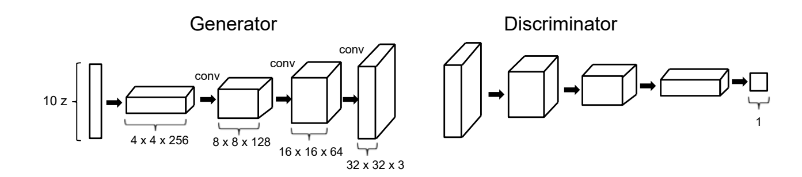
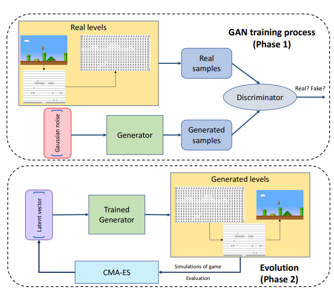

# DagstuhlGAN

[⬅ Zpět na přehled](Overview.md)

## Shrnutí článku a jeho účel
DagstuhlGAN (Repozitář: [https://github.com/CIGbalance/DagstuhlGAN](https://github.com/CIGbalance/DagstuhlGAN))  
Cíl článku: Generovat levely z jednoho příkladového levelu pomocí jednoduché GAN architektury a optimalizovat vstupy pomocí CMA-ES.  
Náš cíl:  
- Replikace výsledků a použití MFF A* v evoluční fázi.  
- Vlastní fitness funkce pro evoluci vektorů.  
- Analýza evoluce a levelů (MFF A* vs. Baumgarten).

## Popis
DagstuhlGAN je procedurální generátor úrovní, který využívá jednoduchý GAN k učení z jednoho trénovacího příkladu a následně optimalizuje vstupy pomocí evoluční strategie CMA-ES. Jeho hlavním cílem je objevovat nové úrovně v latent space-u GANu. Pro práci byla použita starší verze Mario AI Framework-u.

### Jak to funguje
**Trénování GAN** – DagstuhlGAN je DCGAN trénovaný pomocí WGAN. Discriminator používá strided convolutions a LeakyReLU, zatímco generátor využívá fractional-strided convolutions a ReLU, včetně výstupu. Do diskriminátoru vstupují one-hot vektory (10 kanálů, 32×32). Latentní vektor má délku 32. Výstupní úroveň (10×32×32) se ořízne na 10×28×14 a dekóduje pomocí argmax operátoru.

**Evoluční optimalizace** – Algoritmus CMA-ES se používá k optimalizaci latent vectors tak, aby generované úrovně splňovaly požadovaná kritéria, jako je určitý počet nepřátel nebo hratelnost. Pro vyhodnocení hratelnosti se využívá A* agent od Baumgartena, který testuje, zda lze úroveň dokončit, a analyzuje počet potřebných skoků. Pro CMA-ES je použita tato fitness funkce: Pokud je level dokončitelný a má hodně skoků => je zajímavý (chceme dostávat takovéto levely). Snaží se tedy najít levely, kde agent musí hodně skákat, ale který jde i zároveň dokončit.

### Nedostatky
- Dokončitelnost úrovní vyhodnocuje A* agent od Baumgartena, který je méně úspěšný než MFF A*.
- Velká časová náročnost hledání vektorů pomocí A* agenta od Baumgartena.
- Kód je zastaralý (python, java, knihovny, framework) a dokumentace nedostatečná.
- Malá velikost (i kvalita) výstupních levelů (a levelů při hledání vektorů pomocí CMA-ES).
- Chybějící záruka hratelnosti – Vygenerované úrovně můžou být nehratelné.
- Možné artefakty – Algoritmus někdy generuje rozbité struktury (např. nekompletní trubky v Super Mario Bros.), což ovlivňuje vizuální (i funkční kvalitu) úrovně.

### Navrhovaná vylepšení
- Aktualizovat Mario AI Framework na novější verzi (především proto abychom mohli použít MFF A*).
- Pro CMA-ES optimalizaci používat MFF A* namísto A* agenta od Baumgartena a porovnat kvalitu a dokončitelnost levelů.
- Zkusit urychlit hledání vektorů a vylepšovat fitness pomocí hledání cesty do cíle jen z textového souboru bez dynamických prvků.
- Zkusit jiné fitness funkce než které popisuje článek (doba dokončení levelu; backtracked nodes; dokončitelné levely s co nejvíce nepříteli).
- Natrénovat generátor na těžším, členitějším levelu (krys-2).
- Vytvořit pomocný kód pro analýzu a zanalyzovat (vytvořit grafy fitness - počet iterací), pro porovnání evolucí s Baumgartenem a s MFF A*.

## Související soubory
- [Instalace a použití](Instalace-Dagstuhl.md)  
- [Implementované změny a výsledky](Modifikace-Dagstuhl.md)
