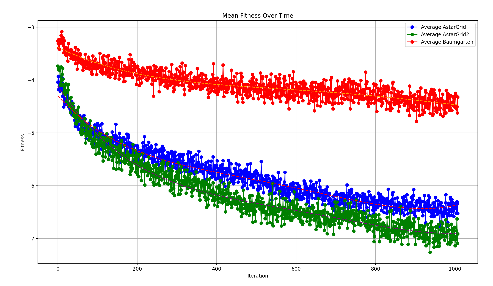

# DagstuhlGAN - Implementované změny a výsledky

[⬅ Zpět na přehled](Overview.md)

## Implementované změny

### Úprava výběru GANu
Ve skriptu `gan_optimize` byl upraven způsob výběru mezi různými GAN modely. Také v `generator_ws` byl změněn způsob, jakým se načítají jednotlivé modely.

### Úpravy v CMAMarioSolver (adresář `marioaiDagstuhl/src/cmatest`)
- Zde lze změnit počet iterací (EVALS).
- Zde lze změnit počet evolvovaných levelů (loops).

### Úpravy ve fitness evaluaci
Funkce `valueOf` v rámci třídy `MarioEvalFunction` byla přepracována. Jejím úkolem je vracet výsledné fitness skóre pro jeden level nebo latent vector. Vzhledem k implementaci několika nových fitness funkcí nyní `valueOf` primárně slouží jako zprostředkovatel, který volá jednu z těchto nových funkcí (např. `levelGridJumpFitness`, `levelBacktrackFitness` atd.) a vrací její výsledek.

Přepracovaná funkce `levelFromLatentVector` kvůli nové stringové reprezentaci levelů v nové verzi Mario AI Frameworku.

### Úpravy funkce `simulateOneLevel` v `MarioProcess.java` (adresář `marioaiDagstuhl/src/communication`)
Tato funkce zajišťuje simulaci jednoho levelu pro získání klíčových informací pro fitness (počet skoků, dokončení levelu apod.). Kvůli přechodu na nový framework musely být provedeny řada změn pro stringovou reprezentaci levelů (nejen zde). Pomocí této funkce byly přidány různé další fitness funkce, kde byli testováni různí agenti. (je potřeba manuálně nastavit, který agent se použije).

### Úpravy v adresáři `viewer` (adresář `marioaiDagstuhl/src/viewer`)
- Úpravy kvůli přechodu na stringovou reprezentaci levelů (Update frameworku).
- Přidán `MarioLevelSaver` pro ukládání generovaných úrovní.

### Úpravy agentů
- **Baumgarten agent** nyní počítá backtracked nodes.
- **MFF agent** nyní umí počítat počet skoků.

### Fitness výpočet (CMA-ES minimalizuje fitness, proto se v kódu přidává mínus)

- **Původní jump fitness**:
  - fitness = procento dokončení úrovně (pokud agent level nedokončil).
  - fitness = procento dokončení úrovně + jump count (pokud level dokončil).
- **LevelGrid fitness**:
  - fitness = procento dokončení úrovně (pokud agent level nedokončil).
  - fitness = procento dokončení úrovně + static jumps count (pokud level dokončil).
  
- **Backtrack fitness**:
  - fitness = procento dokončení úrovně (pokud agent level nedokončil).
  - fitness = procento dokončení úrovně + backtracked nodes (pokud level dokončil).
  
- **Enemies fitness**:
  - fitness = procento dokončení úrovně (pokud agent level nedokončil).
  - fitness = procento dokončení úrovně + počet nepřátel (pokud level dokončil).
  
- **RunTime fitness**:
  - fitness = procento dokončení úrovně (pokud agent level nedokončil).
  - fitness = procento dokončení úrovně + doba dokončení levelu (pokud level dokončil).

V adresáři `marioobjectives` jsou .java soubory, které vypadají jako fitness funkce pro `AgentProgression`, ale jejich skutečné použití jsme nenalezli. Fitness skóre se totiž počítá v `valueOf` v `MarioEvalFunction`. Je tedy pravděpodobné, že tyto soubory nebyly autory využity a zůstaly ve projektu omylem. Stejná situace může platit i pro další soubory.

## Výsledky

### Testování fitness funkcí Baumgarten vs. MFF AStarGrid (vs. MFF Astar vs. Grid search)

### Výsledky porovnání MFF AStarGrid vs. Baumgarten:
- Vyšší úspěšnost v dokončení levelů.
- Rychlejší vylepšování fitness.
- Efektivnější runtime a stabilnější výsledky.
- Baumgarten často trpí zbytečně nadměrným skákáním, což vede k tomu, že fitness se sice vylepšuje, ale levely samy o sobě často zůstavají nezajímavé.
  

#### Původní jump fitness:
- **MFF-A Grid*** byl rychlejší a dosahoval vyššího fitness skóre než Baumgarten.
- S opravami skoků (AStarGrid2 a AStarGrid3) se zlepšila schopnost dokončit i těžší levely.

#### Run-time porovnání:
- Baumgarten byl nejpomalejší.
- MFF AStar měl stabilní runtime a byl nejefektivnější.

#### Backtracked nodes:
- Baumgarten velmi rychle dosáhl vysokého množství backtracked nodes i pro jednoduché levely.

#### Počet skoků bez dynamických prvků:
- Přímé počítání v kódu nefungovalo dobře, lepší byla analýza textového výstupu.
- Vylepšování přes Grid Search bylo rychlé a efektivní.
- Poměrně zajímavé levely.

### Krys generátor – Jump test:
- 55 generací vylepšování pomocí Baumgartena trvala přes 40 hodin.
- MFF AStarGrid měl lehce lepší výsledky. 
  - (U Baumgartena možná generátor preferoval vytvářet levely, kde se zasekával a opakovaně skákal).
### Testování na levelu krys-1:
- Ukázalo se, že je vhodné zaměřit se na generování různorodějších levelů, protože originální level 1-1 generoval příliš jednotvárné úrovně.
  - (Ovšem také to vede k delší době vylepšování levelů).

### Další poznámky:
- MFF AStarGrid byl velmi rychlý při CMA-ES evoluci oproti Baumgartenovi, vylepšování přes samotný Grid search byl ještě rychlejší.
- Grid Search měl problém s nižšími levely – nebral díry jako díry, což ovlivnilo výsledky.
    - Při umělém zvýšení výšky levelu došlo ke zlepšení výsledků.
- Při vylepšování pomocí MFF AStarGrid často záleží na předaných parametrech.
- Generované levely jsou velmi malé a poměrně špatně se tedy porovnávají.

## Související soubory

- [DagstuhlGAN](DagstuhlGAN.md)  
- [Instalace a použití](Instalace-Dagstuhl.md)  
